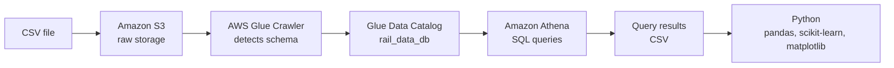
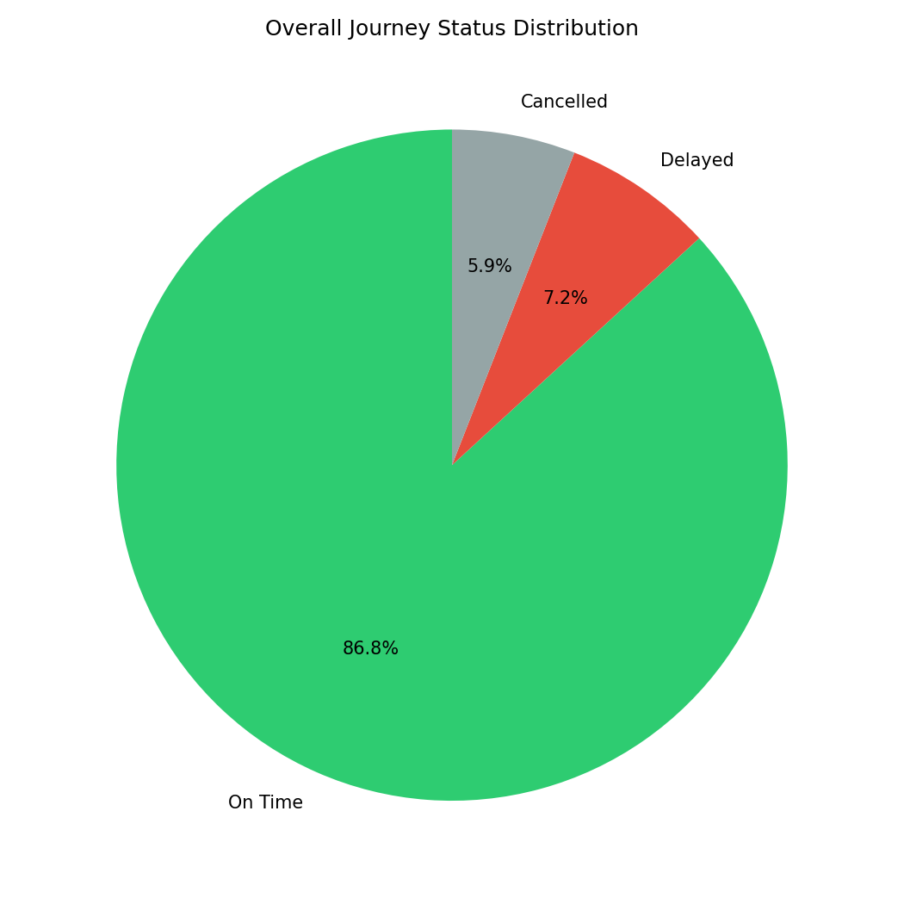
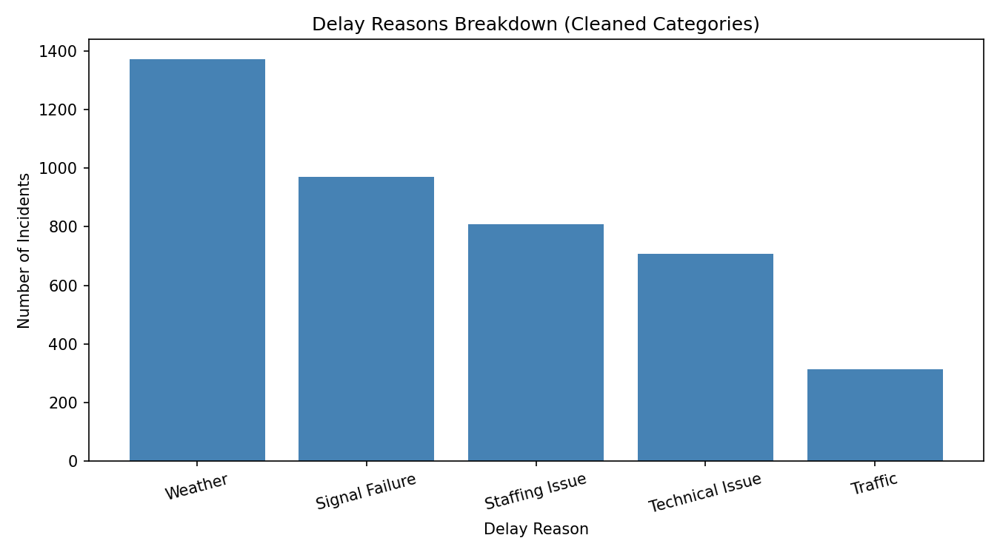
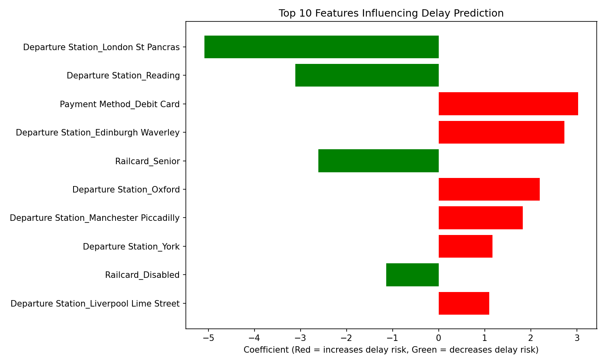

# UK Rail Delay Analysis: AWS Cloud Pipeline with SQL and Python

An end-to-end analysis of 31,653 UK rail journeys, built on AWS so the data is stored, catalogued and queried in the cloud rather than in a local database. SQL in Amazon Athena answers what happened (punctuality, delay causes, stations, tickets, refunds), and a logistic regression model in Python explores which factors are linked to delays.

## Architecture



| Component | Name used | Purpose |
|---|---|---|
| S3 bucket | `vanshika-uk-rail-data` | Stores the raw CSV and Athena query results |
| Glue Crawler | `rail-data-crawler` | Reads the file and builds the table schema automatically |
| Glue database / table | `rail_data_db` / `vanshika_uk_rail_data` | Makes the data queryable |
| Athena | Presto SQL | Runs SQL directly on the data in S3 |
| Region | `eu-west-2` (London) | |

## Dataset

UK Train Rides data from the Maven Analytics Rail Challenge (via Kaggle): 31,653 journeys with ticket, railcard, station, timing, delay reason and refund details. The file is semicolon-delimited, and several column names contain spaces, so they need double quotes in Athena (for example `"journey status"`).

## Repository structure

```
├── data/
│   ├── TrainRidesCleaned.csv          # source dataset
│   └── query_results/                 # Athena query outputs
├── sql/
│   └── queries.sql                    # all six Athena queries
├── images/                            # charts from the notebook
├── rail_delay_prediction.ipynb        # Python modelling
└── README.md
```

Note: `1_5_journey_status_and_refunds.csv` holds the results of both Query 1 and Query 5, since the refund query also returns journey counts by status.

## Key findings (SQL in Athena)

**Punctuality.** 86.8% of journeys ran on time, 7.2% were delayed and 5.9% were cancelled.



**Delay causes.** Weather was the most common cause (1,372 incidents), followed by signal failure (970), staffing (809), technical issues (707) and traffic (314).



**Stations.** Among high-volume stations, Liverpool Lime Street had the highest delay rate (19.7% of 4,561 journeys), followed by Manchester Piccadilly (11.9%). London Paddington was the most reliable at 1.5%. Edinburgh Waverley showed a 100% delay rate, but from only 51 journeys, so I treated it as a sample-size warning rather than a finding.

**Ticket class.** First Class (7.7%) and Standard (7.2%) were delayed at almost the same rate, even though First Class tickets cost more than twice as much on average (£48.86 vs £20.72).

**Refunds.** 30.4% of cancelled journeys and 23.8% of delayed journeys led to a refund request.

**Railcards.** Adult railcard journeys had the highest delay rate (13.7%) and Senior railcard journeys the lowest (2.9%).

## Predictive model (Python)

I built a logistic regression model to predict whether a journey would be delayed, using ticket class, railcard, departure station, payment method and price. Cancelled journeys were excluded so the model compares delayed against on-time journeys only.

**Handling class imbalance.** Only about 8% of these journeys were delayed. The first model reached 93.8% accuracy but caught only 36% of delayed journeys, because it mostly predicted "on time". Retraining with `class_weight='balanced'` lowered accuracy to 81.4% but raised recall for delayed journeys to 73%, at the cost of lower precision (26%). For flagging journeys at risk of delay, catching more delays matters more than overall accuracy.



**Cross-check with SQL.** The model's coefficients agreed with the SQL results: Senior railcards were linked to lower delay risk, and Liverpool Lime Street, Manchester Piccadilly and Edinburgh Waverley to higher risk.

## Data quality notes

- **Duplicate delay categories.** The raw "reason for delay" field had the same cause written in different ways (for example different capitalisation), so I grouped them with `CASE WHEN` before counting.
- **Small samples.** Station rates are only meaningful for stations with enough journeys, as the Edinburgh Waverley example shows.
- **Extra blank rows in Athena.** Athena returned around 100 rows with empty values (31,764 rows in total, against 31,653 when the same file is read in pandas). These are most likely parsing artefacts of the semicolon-delimited file. They appear as a blank group in the query results and are left out of the percentages above.
- **Missing railcards.** A blank railcard means the passenger had no railcard, so I filled these as "None".

## Limitations

- Coefficients show association, not cause. For example, paying by debit card came out as linked to higher delay risk, but payment method cannot plausibly cause a delay. It is more likely related to other factors such as route or time of travel.
- The model uses only booking details. Adding departure time, day of week or route would likely improve it.

## Cost and security

- Worked through an IAM user (`vanshika-analyst`) rather than the root account.
- Set a zero-spend AWS budget alert to catch any unexpected charges.
- For this learning project the IAM user was given broad permissions. In a production setting I would scope these much more tightly.

## Next steps

- Build an interactive Tableau dashboard from the query results.
- Add time-based features (departure hour, day of week) to the model.
- Model cancellations separately from delays.

## Tools

AWS (S3, Glue, Athena, IAM) · SQL (Presto) · Python (pandas, scikit-learn, matplotlib) · Jupyter Notebook
